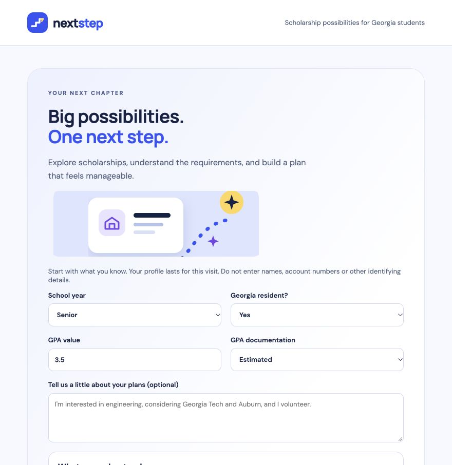
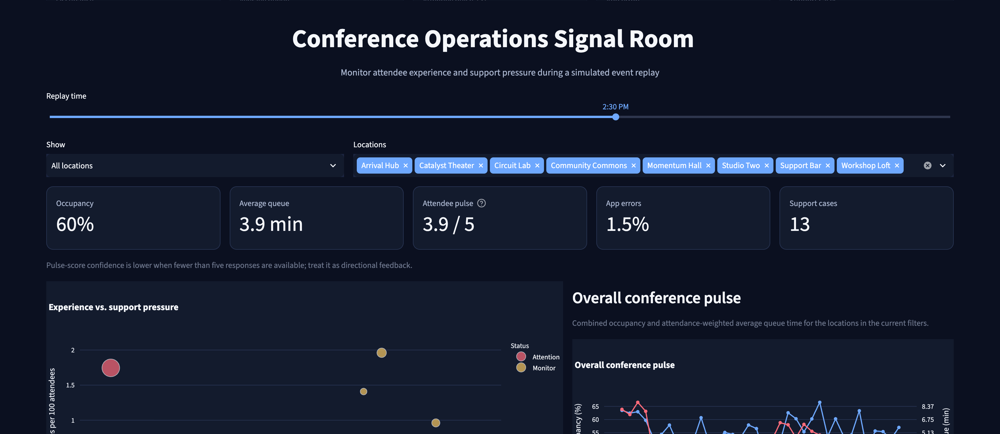

# Hi, I’m Deepal 👋

**Product thinker and hands-on AI builder with a background in technical strategy and data analysis.**

I’m interested in how AI and data can help people make better decisions. I build prototypes to explore that question—from defining the user’s problem and shaping the experience to testing the system and understanding its limitations.

I use AI-assisted development to turn ideas into working products and demos, with a focus on useful experiences, clear trade-offs, and honest evaluation. Here, I share what I build, the decisions behind it, and what I learn along the way.

🔎 Frame the problem → 🛠️ Build & test → 📊 Evaluate → ✍️ Share what I learn

## 🎓 NextStep Scholarships

Helping Georgia students explore scholarships, understand potential matches, and plan their next steps. Combines cited AI explanations with explicit eligibility checks and visible uncertainty.

**Product focus:** Guided discovery · Trust · RAG evaluation  
*Course demo with a limited corpus; not a final eligibility determination.*

[Live demo](https://nextstep-scholarships.replit.app/) · [Case study](https://github.com/dsilvadeepal/nextstep-scholarships/blob/main/docs/CASE_STUDY.md) · [Code & product decisions](https://github.com/dsilvadeepal/nextstep-scholarships)

## 📊 Signal Room

Helping event operations leads spot attendee friction and decide where to investigate. Brings queues, occupancy, feedback, and support signals into an interactive dashboard.

**Product focus:** Decision support · Data storytelling · Human judgment  
*Synthetic data and simulated replay; no LLM or automated dispatch.*

[Code & walkthrough](https://github.com/dsilvadeepal/signal-room-conference-ops)

---

**Exploring:** AI evaluation, retrieval-augmented generation, and tools that help people make better decisions.
